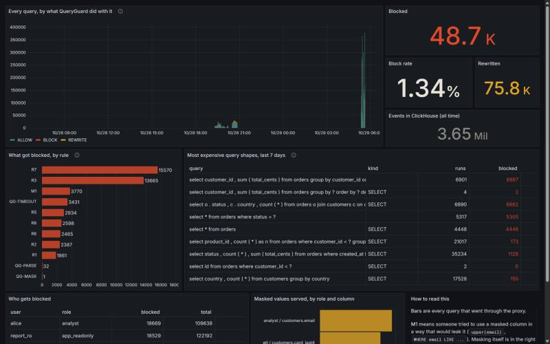
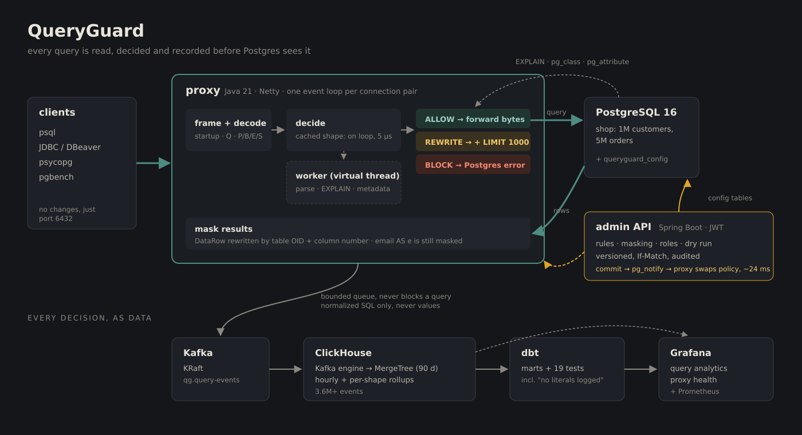

# QueryGuard


**A PostgreSQL proxy that reads every query before your database does.**

It speaks the Postgres wire protocol on port 6432 and decides per query: let it through, rewrite it,
or refuse it with a real Postgres error. It masks columns like `email` and `card_last4` depending on who's
asking, and streams every decision through Kafka into ClickHouse. psql, JDBC, psycopg and DBeaver
all work unchanged; they just connect to a different port.


That's a real recording against the compose stack (`docs/demo/demo.tape`, made with VHS; nothing edited).
bob's DELETE never reaches Postgres. alice is an analyst, so her email column is masked even though she
renamed it, wrapping it in `upper()` is refused, and her expensive query is priced with EXPLAIN and
refused before Postgres runs it.



---

## Why build this

Most database incidents I've seen up close weren't clever. Someone forgot a `WHERE`. Someone ran `SELECT *`
on the biggest table at 9am. A dashboard query quietly went from 200 ms to 40 s.

Database permissions answer *"can this user touch this table?"* They don't answer *"is this query a bad
idea?"* or *"should this person see raw emails?"* That needs something that reads the SQL, asks Postgres
what it'll cost, and says no before the database pays for it. It should also keep a record you can actually query.

It is **not** a pooler. PgBouncer pools connections and deliberately ignores your SQL. QueryGuard reads it.
They stack fine: client → QueryGuard → PgBouncer → Postgres.

## Run it

You need Docker. That's it, no local Java.

```bash
git clone https://github.com/thotaarchitha/queryguard.git && cd queryguard
docker compose up -d --build --wait          # ~3 min first time: builds, seeds 6M rows
docker compose --profile traffic up -d       # optional: fake users generating traffic
```

| | |
|---|---|
| Proxy (point psql here) | `localhost:6432`, users `alice` `bob` `etl_user` `report_ro`, password = username |
| Admin API + Swagger | http://localhost:8080/swagger-ui.html (`admin` / `admin-dev`) |
| Grafana | http://localhost:3000 (no login needed to view) |
| Every rule, demoed | `make demo`, or run `infra/demo/rules.sql` through psql |

The shop data is generated with `generate_series`: 1M customers, 5M orders. Emails are `@example.com` and
phones are in the 555-01xx fiction range, so none of it can be a real person.

## What it does

**Rules**, from [`infra/rules/default-rules.yml`](infra/rules/default-rules.yml) or the admin API:

| | Rule | Applies to |
|---|---|---|
| R1 | UPDATE/DELETE with no WHERE: block | everyone |
| R2 | DROP/TRUNCATE: block | everyone but admin |
| R3 | EXPLAIN cost over 100,000: block | analysts |
| R4 | SELECT with no LIMIT: rewrite with `LIMIT 1000` | analysts |
| R5 | `SELECT *` over 1M estimated rows: block | everyone but etl/admin |
| R6 | Cross join or a join with no condition: block | everyone |
| R7 | Writes outside the Sat/Sun 02:00-04:00 UTC window: block | read-only apps |
| R8 | `pg_sleep`, `pg_read_file`, `dblink`...: block | everyone |

Multi-statement queries are checked statement by statement (`SELECT 1; DROP TABLE x` is blocked).
`EXPLAIN ANALYZE DELETE` counts as a DELETE, and comments can't fake a WHERE clause.

**Masking by column identity, not name.** Every result column in Postgres' RowDescription carries its
source table OID and column number. QueryGuard maps those to `customers.email` and rewrites DataRows on
the way back. `SELECT email AS e` is still masked. The ways to dodge that (`upper(email)`,
`WHERE email LIKE 'a%'`, `ORDER BY email`, `row_to_json(c)`, UNION, subqueries, COPY) are refused up front
for roles that have the column masked. There's a test for each one.

**Live policy.** `PUT /rules/R3` through the JWT-secured admin API, and the proxy has the new rule
about 24 ms later, with no restart. Edits use ETag/If-Match, so two admins can't silently overwrite each other.
Every change is versioned and audited. `POST /rules/test` dry-runs a query against the live policy.

**Analytics.** Every decision becomes an event (normalized SQL only, never values) → Kafka →
ClickHouse (MergeTree + hourly and per-shape rollups) → Grafana, plus dbt marts with tests.

## How a query gets through



Blocked queries aren't answered by the proxy. It sends Postgres a placeholder that fails to parse and
swaps Postgres' error for its own on the way back, so Postgres handles all the protocol state
(aborted transactions, the rest of an extended-protocol batch). Source: `docs/architecture.svg`.

## Numbers

Measured on one laptop with everything running at once. Full write-up, methods and caveats in
[`bench/RESULTS.md`](bench/RESULTS.md).

| | |
|---|---|
| Decision step, known query shape (JMH) | **5 µs** p50 (vs ~800 µs parsing every query) |
| Rule change → live in the proxy | **24 ms** median |
| Admin API, 200 users with realistic pacing | p95 **10-16 ms**, 0 errors; max **1,936 req/s** |
| Query events in ClickHouse | **3.6M+**, 0 dropped; 130K events/s catch-up after an outage |
| pgbench through the proxy (prepared, 32 clients) | 9.4K TPS vs 25K direct, on shared CPUs (see caveats) |

The throughput overhead is the weak number. On a laptop where pgbench, Postgres, Kafka, ClickHouse and
the proxy share 12 threads, the proxy's ~0.7 ms of CPU per query comes straight out of Postgres' budget.
RESULTS.md breaks down where that CPU goes.

## The interesting parts

- **[docs/design-decisions.md](docs/design-decisions.md)**: the trade-offs, written as answers to the
  twelve questions I'd expect in an interview (fail-open vs fail-closed, why ClickHouse, scaling to 50K connections...).
- **[docs/bug-journal.md](docs/bug-journal.md)**: what broke. The best one: under load, EXPLAIN timed out,
  the cost rules failed open, and the expensive queries they exist to stop made the overload worse.
- **[docs/protocol-notes.md](docs/protocol-notes.md)**: real bytes of a Postgres startup, captured through the proxy.

## Limitations

- **No TLS termination.** The proxy answers `N` to SSLRequest. Clients that require TLS won't connect.
- **No pooling.** Client connections map 1:1 to Postgres connections. Auth passes through untouched,
  so the proxy never has credentials to pool with.
- **Binary-format masked columns come back NULL** rather than masked text.
- **Masking doesn't see through views or SECURITY DEFINER functions** owned by someone else; those need their own policy.
- **Blocking in the middle of an extended-protocol batch** relies on Postgres' own error handling. Earlier
  statements in the same implicit transaction are rolled back, exactly as with any other error.
- **JSqlParser doesn't know all of Postgres.** Unparseable reads are allowed and unparseable writes refused;
  `libpg_query` would be the real fix.

## Project layout

```
proxy/        Netty proxy: protocol, decisions, masking, events, metrics
admin-api/    Spring Boot: rules, masking, roles, dry run, stats; Flyway schema
common/       rule engine, SQL analysis, masking guard (shared so dry runs can't disagree with the proxy)
analytics/    ClickHouse DDL, dbt project, Grafana dashboards (generated by a script), Prometheus
bench/        pgbench, JMH, k6, traffic generator, connection test, RESULTS.md
infra/        seed data, rules, demo script, Helm chart
```

## Development

```bash
./gradlew build              # unit tests
./gradlew integrationTest    # Testcontainers: real Postgres 16 and real pgjdbc traffic
make k8s-up                  # kind cluster + Helm chart + smoke test (needs kind, kubectl, helm)
```

No local Java? Prefix with `docker run --rm -v "$PWD:/src" -w /src gradle:8.10.2-jdk21`.

Tests: 110 in total: 82 unit tests for the rule engine and proxy, 14 proxy integration tests with real
Postgres (pgjdbc traffic plus live reload over LISTEN/NOTIFY), 14 for the admin API (6 against a real
database), plus 19 dbt checks. Line coverage is 87.7% on the decision path (analysis, rules, masking,
protocol) and 79.6% overall, unit and integration combined; `python bench/coverage.py` prints it per package.
CI runs all of them, lints the chart and Dockerfiles, pushes every demo query through the compose stack,
and publishes images to GHCR.

---

Built by **Architha Reddy Thota**. I'm a master's student, and before that I spent three years as a
software engineer on backend systems, with a fair amount of data work along the way. This is where
those two halves meet. MIT licensed.
